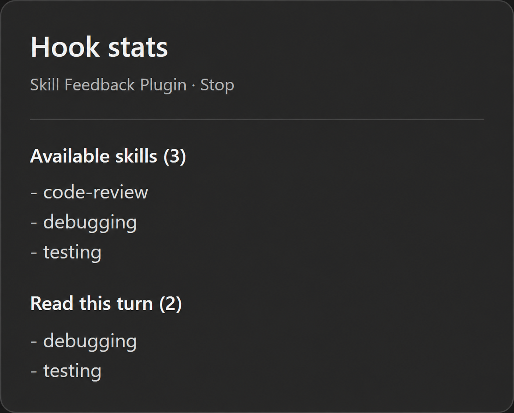

# Skill Feedback Plugin

See available skills and skills read this turn in Codex desktop's **Hook stats**.



*Illustrative preview with sample skills.*

- **Available skills:** the catalog supplied to the chat.
- **Read this turn:** skills with successful file reads during the response.

Each skill appears once, including reads of files inside its directory.
Instructions retained from earlier turns do not count as new reads.

## Install

Requires Git, Python 3.12 on the app's PATH as `python`, and a Codex CLI with
`plugin` commands.

```powershell
git clone https://github.com/kwonzweig/codex-skill-feedback.git
cd codex-skill-feedback
codex plugin marketplace add .
codex plugin add skill-feedback@skill-feedback-local
```

Allow the hook in **Settings > Hooks**. After a response, open **Hook stats** and
expand **Skill Feedback Plugin**. Both lists share one icon.

## Limits and privacy

Verified on Windows with Codex desktop 26.930.3930.0 and backend 0.160.0. Other
hosts are unverified. The [transcript format may change](https://learn.chatgpt.com/docs/hooks#common-input-fields).

Counts completed command records with a parsed `read` path, exit code zero,
nonempty output, and no stderr. MCP reads, subagent reads, and unrecognized shell
commands are excluded. Missing data produces an unavailable message. File reads
do not prove the model followed a skill's instructions.

One Python file using the standard library. Reads the local transcript without
network requests or file writes. Codex retains the output in its hook records.

## Update or remove

From your clone:

```powershell
git pull --ff-only
codex plugin remove skill-feedback@skill-feedback-local
codex plugin add skill-feedback@skill-feedback-local
```

Allow the hook again if prompted. To uninstall, run only the remove command.

## Development

```powershell
python -B -m unittest discover -s tests -v
```

Tests use synthetic transcripts. Keep private logs out of bug reports.
Use `.codex-plugin/plugin.json`; a root `plugin.json` breaks hook discovery in
the verified backend.

[MIT License](LICENSE).
